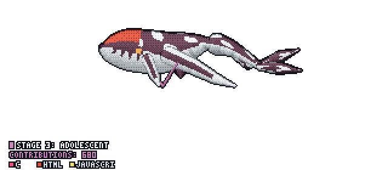

<div align="center">

<pre>
 ██████╗███████╗███╗   ██╗██╗  ██╗
██╔════╝██╔════╝████╗  ██║╚██╗██╔╝
██║     █████╗  ██╔██╗ ██║ ╚███╔╝
██║     ██╔══╝  ██║╚██╗██║ ██╔██╗
╚██████╗███████╗██║ ╚████║██╔╝ ██╗
 ╚═════╝╚══════╝╚═╝  ╚═══╝╚═╝  ╚═╝
</pre>

<a href="https://github.com/Cenx-bash">
  
</a>

<br><br>

<a href="https://cenx-bash.github.io/Professional-Portfolio/"></a>
<a href="https://www.linkedin.com/in/karl-ancel-dimabayao-770179368/"></a>
<a href="mailto:zenn.studio.01@gmail.com"></a>


</div>

---

## `> whoami`

```ts
const zenn = {
  name:     "Karl Ancel T. Dimabayao",
  alias:    ["Zenn", "Cenx Bash"],
  role:     "Full-Stack Developer · Systems Architect",
  studying: "BS Information Systems @ Ateneo de Naga University",
  codingSince: 2023,
  focus:    ["Game dev (Three.js / WebGL)", "Local AI in Java", "Full-stack web platforms"],
  philosophy: "Ship clean, minimal, and fast.",
};
```

## `> stack`

<div align="center">


</div>

## `> featured projects`

| Project | What it is | Stack |
|---|---|---|
| **BUNKER-9: DELIRIUM SWEEP** | Browser-based horror FPS | Three.js · WebGL · JavaScript |
| **Kape** | Personal project: a local AI built from scratch in Java | Java |
| **PetCareConnect** | Pet care web app with auth flows and a minimalist UI | Node.js · Express · MySQL |
| **Pawssible** | Stray Animal Rescue and Assistance Management System | Web · MySQL |
| **ReBayan** | Philippines-first marketplace for recycled and upcycled products | Startup · Product |

<div align="center">

<a href="https://github.com/Cenx-bash?tab=repositories"></a>

</div>

## `> stats`

<div align="center">


</div>

## `> contribution snake`

<div align="center">


</div>

## `> my tulkun`

<div align="center">

<a href="https://github.com/PramudithaN/git-tulkun">
  
</a>

<sub>Grows with my contributions. Resets every Jan 1.</sub>

</div>

---

<div align="center">

<a href="https://cenx-bash.github.io/Professional-Portfolio/">Portfolio</a> ·
<a href="mailto:zenn.studio.01@gmail.com">Email</a> ·
<a href="https://www.linkedin.com/in/karl-ancel-dimabayao-770179368/">LinkedIn</a> ·
<a href="https://github.com/Cenx-bash">GitHub</a>

</div>


